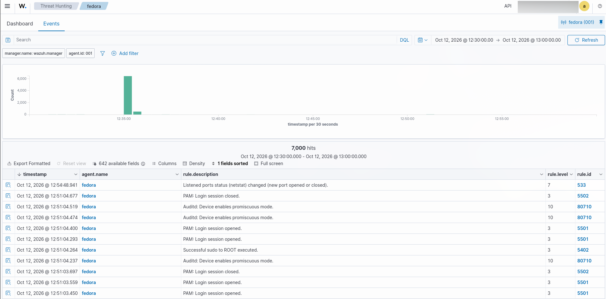

# Home SOC Lab - Wazuh Detection Project

Small home lab where I simulated a few common attacks and watched how Wazuh (open-source SIEM) detected and logged them. Built this to get hands-on with SIEM tooling and log analysis, not just read about it.

## Setup

- Attacker: Kali Linux VM 
- Target: Fedora 43 host, running OpenSSH and Apache, with firewalld rules limiting inbound 22/80 to the lab subnet only
- SIEM: Wazuh 4.14.8, deployed single-node via Docker Compose, with an agent installed on the Fedora target

## What I did

### Nmap scan
Ran a SYN stealth scan from Kali against the target:

```bash
nmap -sS <target-ip>
```
This one didn't actually trigger a host-based alert - SYN scans don't touch application services or generate logs on their end, so catching this needs network-level monitoring instead (firewall drop logs, or something like Suricata).

### SSH brute force
Threw rockyou.txt at SSH with Hydra:
```bash

    hydra -l victim -P /usr/share/wordlists/rockyou.txt -t 1 -W 5 ssh://<target-ip>
```
Wazuh caught this one well. Rule 5710/5760 fired on each failed login, and once it saw enough failures from the same source in a short window, Rule 5763 escalated it to a brute-force alert (level 10). SSH's own connection throttling also kicked in and slowed the attack down on its own.

### Nikto web scan
```bash

    nikto -h http://<target-ip>
```
Found a handful of real issues: missing security headers (CSP, HSTS), HTTP TRACE still enabled, and directory listing exposed on /icons/. Wazuh picked up the scan itself as a wave of 400 errors from one IP (rule 31101), then escalated to a scanning alert (rule 31151) once the volume crossed its threshold.

## What I'd fix

- Turn off password auth on SSH, use keys only
- Fail2ban or Wazuh active response for repeated auth failures
- TraceEnable Off in httpd.conf
- Add the missing security headers
- Turn off directory indexing
- Add a network-level IDS (Suricata/Zeek) to catch the stuff that doesn't show up in host logs, like the Nmap scan

## Evidence

Raw CSV export from the Wazuh dashboard is in evidence/.
## Dashboard Screenshot


